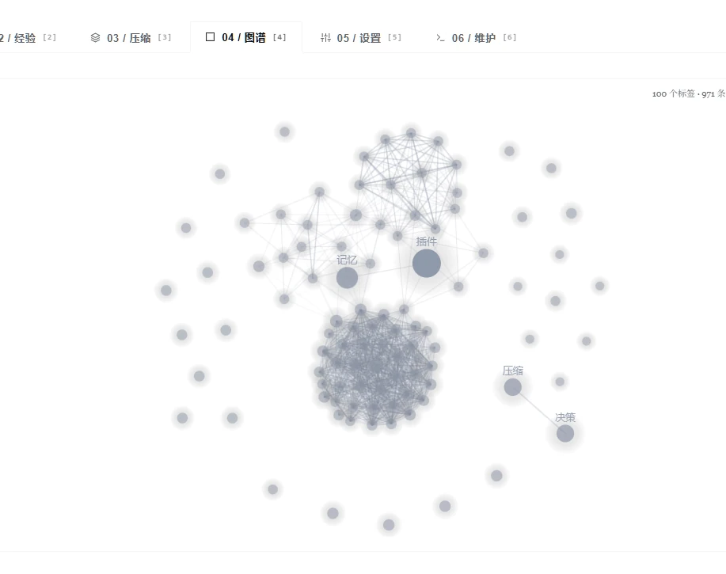
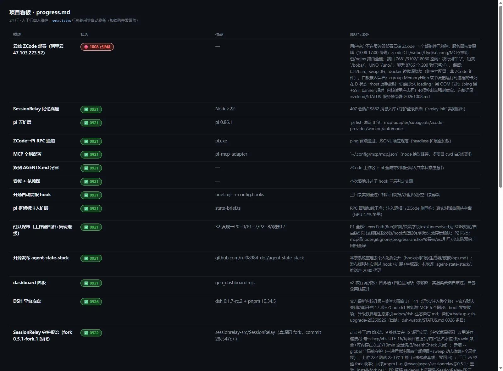
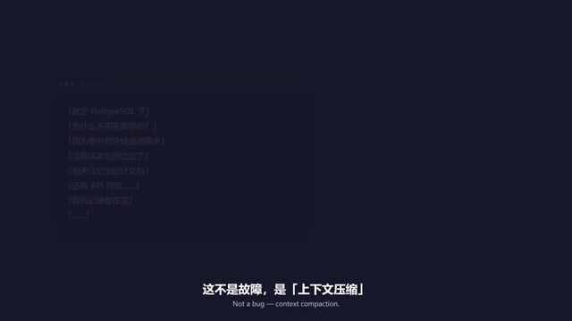
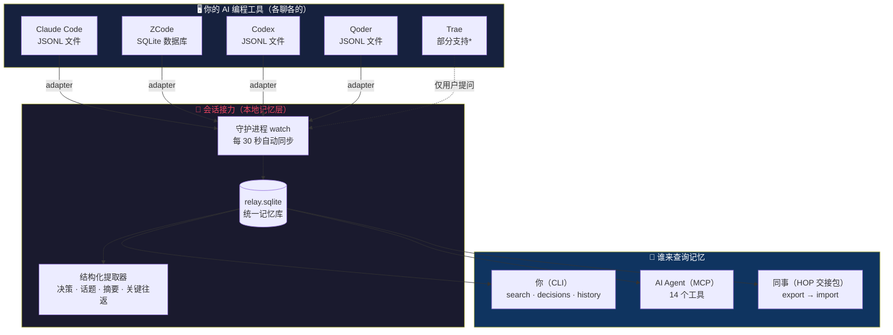
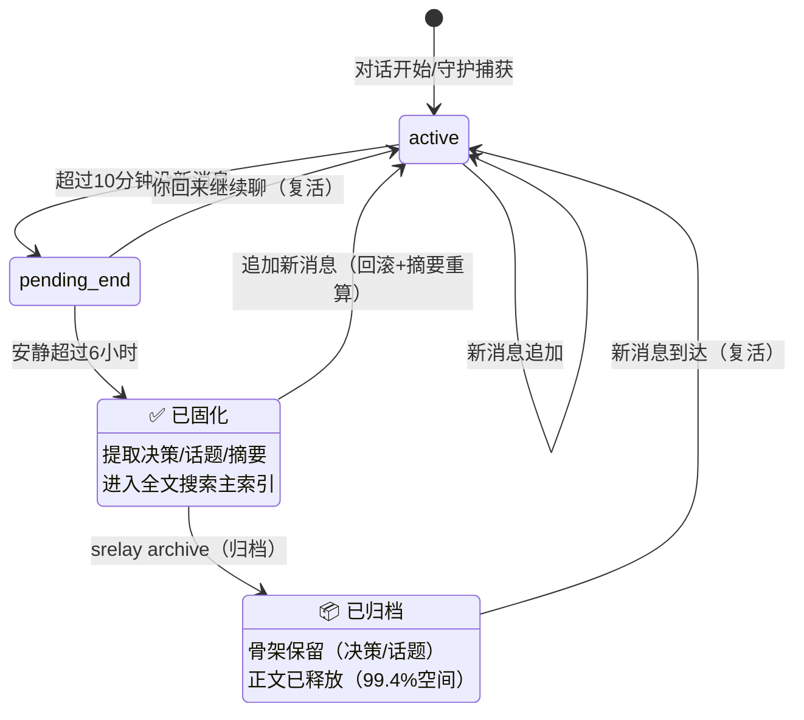
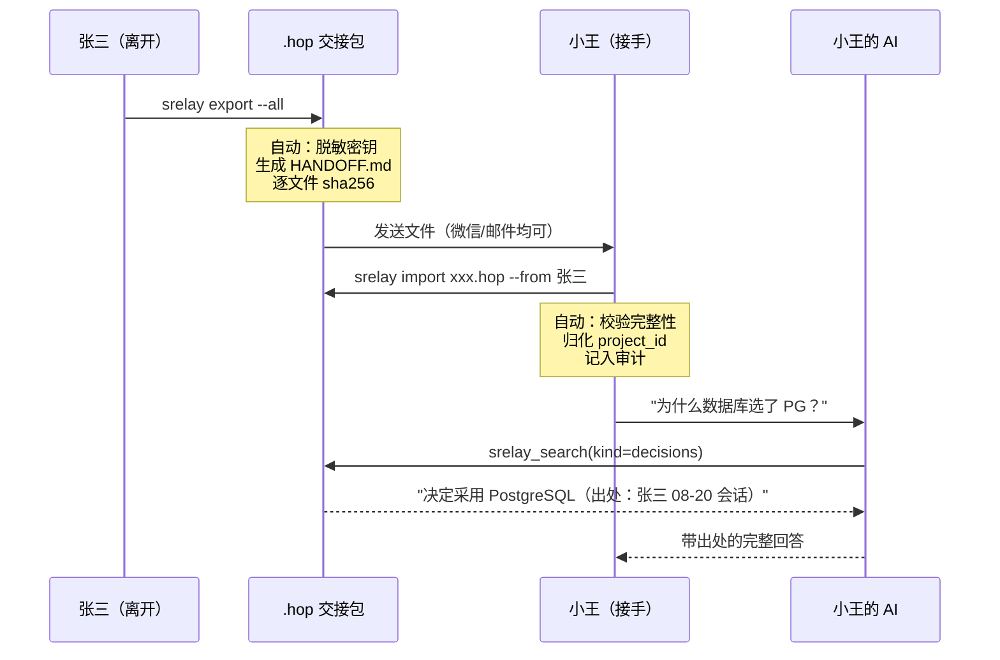
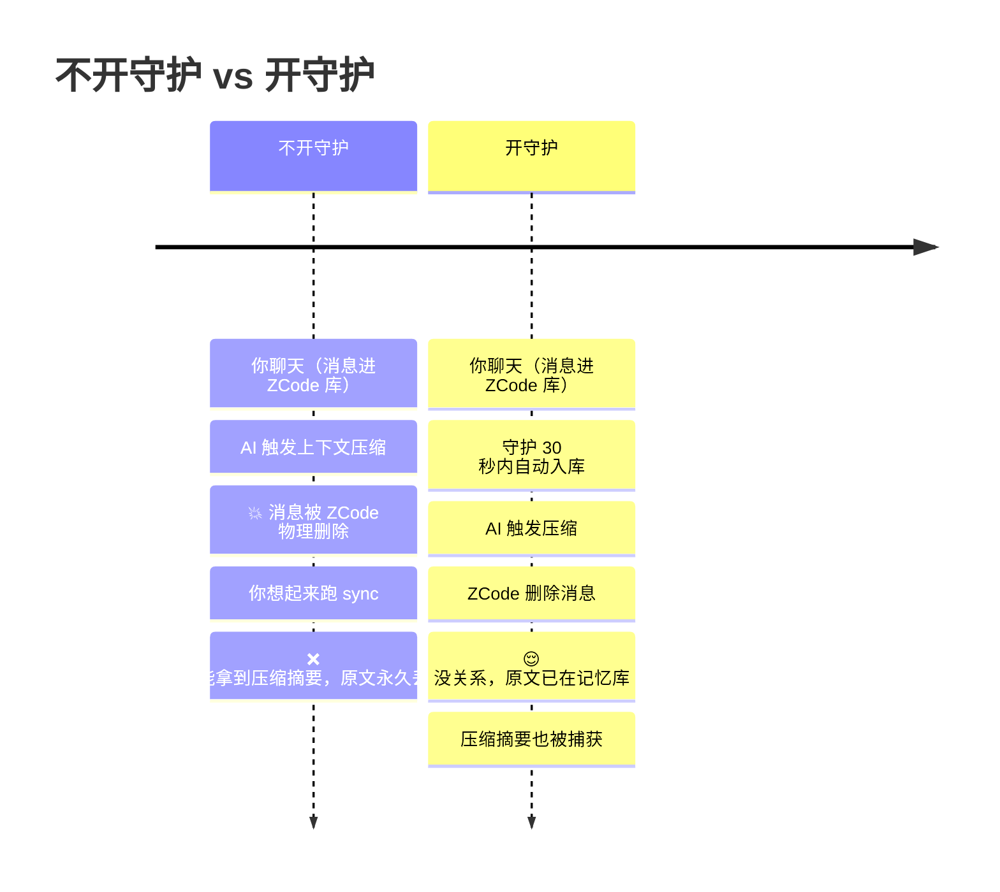

# 会话接力 SessionRelay

简体中文 | [English](./README.en.md)

[](https://github.com/rui08984-dot/SessionRelay/actions/workflows/ci.yml)
[](https://www.npmjs.com/package/@ewanjasper/sessionrelay)
[](https://www.npmjs.com/package/@ewanjasper/sessionrelay)


> **属于项目、不属于任何厂商的本地记忆层。**
> Memory is always complete. Retrieval is always yours to shape.
> 记忆始终完整收录；检索边界由你划定。

你和 AI 聊了 3 天的方案，不应该随关窗消失。它属于项目，属于下一个接手的人。

## 关于本仓库

> **独立维护**：https://github.com/rui08984-dot/SessionRelay
>
> 本项目起源于 [EwanJasper/SessionRelay](https://github.com/EwanJasper/SessionRelay)（MIT），
> 但**已独立演进** —— 代码、文档、工具面、缺陷修复都不再跟随上游。
> 遇到问题请提到**本仓库**的 Issues，不要去上游问。


### 能力补齐

| 变化 | 说明 |
| ---- | ---- |
| **DSH 面板工具 7 → 14** | 与 MCP 侧（`srelay serve`）能力对齐。新增 `srelay_related`（以会话为锚推荐相关历史，治「换个角度就搜不到」）、`srelay_history`、`srelay_decisions`、`srelay_unresolved`、`srelay_stats`、`srelay_pin`、`srelay_lessons`（**查跨项目经验库** —— 开场自动注入只保底 3 条，库大后靠它主动深挖）。**全部只包 CLI 已有命令，不另写内核逻辑** |
| **标签图谱可视化** | 面板「图谱」页新增**力导向图**：100 节点 / 1200 边，斥力+弹簧+向心三力模拟，节点大小映射会话数，悬停高亮邻居。纯 Canvas 手写，零第三方依赖 |
| **实时刷新** | 图谱页 15 秒轮询，改配置 / 重建图谱后无需手动刷页面 |
| **ZCode MCP 接入** | 注册 `sessionrelay` 到 ZCode 的 `mcp.servers`，ZCode 侧从「只能被动接收简报」变成「能主动查/记」 |

### 修掉的缺陷（都是「静默失效」类）

这几条的共同形状：**把「我不知道」渲染成了「一切正常」**。

| 缺陷 | 后果 |
| ---- | ---- |
| 图谱查询引用了不存在的列名（`e.tag_a`/`e.tag_b`，真实是 `a`/`b`/`w`） | **图谱页从做出来那天起就没显示过一次**；异常被 `withDb` 吞成 null，面板显示「还没建过」而库里躺着 5037 个标签 |
| `export { X } from` 被当成本地变量用 | ZCode 侧简报抛 `ReferenceError` 却被「失败=空输出」契约吞掉 ⇒ **从那次归核起一条简报都没注入过** |
| 门禁把「跳过」算作成功 | dist 重建窗口里两次 `ERR_MODULE_NOT_FOUND` 仍打印「✅ 全部一致」 |
| `watchdogOnline` 用 `() => undefined` 吞掉读错误 | 「全局库打不开」被渲染成「守护离线」 |
| 面板「未决」数全部 `key_questions`（含已回答） | 同一时刻四个入口给出 686 / 55 / 4 / 1，面板那个是错的 |
| 生命周期 `lastAt` 从来没被赋值 | 卡片上「已执行 196 次」配「最近运行：—」 |

修法统一为：**错误必须可见**（`withDb` 补 `onError`）、**判据只有一份**（判活/阈值/过滤收敛成共享函数）、**数字必须绑口径**（计数值带语义过滤）。

### 怎么用

上游的安装与使用方式完全不变，见下方[快速开始](#快速开始)。
本仓库额外提供三个适配器（`integrations/` 目录）——**装哪个取决于你用哪个工具**：

| 工具 | 目录 | 你得到什么 | 要 trust 吗 |
|---|---|---|---|
| **DSH** | `plugins/dsh` + 面板 | 14 个原生工具 + 图形面板 + 每步自动简报 | 否 |
| **ZCode** | `integrations/zcode` | SessionStart 简报 + MCP 14 工具 | 否 |
| **Codex** | `integrations/codex` | SessionStart 简报 + MCP 14 工具 + 技能 | **是**（Codex 要求 `/hooks` 审核） |

> **装 Codex 那条要留意**：装完必须在 Codex 里输入 `/hooks` 手动 trust，否则钩子不会运行。
> 详见 [integrations/codex/README.md](integrations/codex/README.md) —— 这是 Codex 的安全设计，脚本无法代劳。

## 设计初衷：做**轻**，但要做**对**

很多「AI 记忆」项目选择同一条路：**embedding + 本地大模型总结**。
那套方案能跑，但它把三件事绑进了记忆层——**一个模型、一次推理、一条网络**。

我们不要这三样。**记忆层应该像 fsync 一样安静、快、可预期。**

### 我们和「嵌入式神经网络记忆框架」的根本分歧

| | 典型 embedding + 总结方案 | **SessionRelay** |
|---|---|---|
| **存什么** | 向量(原文被摘要后丢弃) | **原文，一字不改** |
| **怎么找** | 向量相似度 | SQLite FTS5 全文 + 中文分词 |
| **要本地大模型吗** | **要**(总结/抽取/打分) | **不要**，零推理依赖 |
| **对话要烧 token 吗** | **要**(每轮喂进去总结) | **0**——捕获在守护侧完成，不进你的上下文 |
| **要联网吗** | 常要(调 API、下模型) | **不要**，全程本机 |
| **首次可用延迟** | 加载模型，数秒到数十秒 | **毫秒级** |
| **记忆会被改写吗** | **会**——摘要即是有损压缩，且不可逆 | **不会**——原文完整，召回原样 |

### 我们主动放弃的三样东西

这不全是赚的，有三处我们是**故意不要**的：

1. **不要「智能摘要」。** 摘要一定丢东西，而且**丢的时候不告诉你**。
   本框架宁可把 5000 字原样摆出来让你自己看，也不给一句「我帮你总结成三句」。
   —— 实测代价：检索结果更「生」，需要你自己扫。这是我们选的。

2. **不要「语义相似」。** 关键词搜不到就是搜不到，不会给你「意思差不多」的结果。
   我们用三个东西补偿：**中文分词**、**共现标签图**(换个角度也能顺着边找)、
   **`srelay_related`**(以会话为锚推荐，治「换个说法就搜不到」)。
   —— 代价：你仍然需要会挑关键词。语义检索作为**可选**能力保留，但**不是默认路径**。

3. **不要「云端同步」。** 库就在项目目录下的 `.sessionrelay/`，拷走就是全部。
   —— 代价：没有多机自动同步。要同步，你自己同步那个目录。

### 那「功能优于」体现在哪

不是「更强」，是**在这个用途上更合适**:

- **对话零 token 成本**：其他方案为了「记住」要消耗上下文，我们**采集在模型之外发生**。
  聊一整天，记忆层的 token 花费是 **0**。
- **确定、可复现**：同一句话，今天搜和明年搜结果一样。不依赖模型版本、不依赖温度。
- **中断安全**：守护进程崩了、断网了、模型下线了——记忆照常写入。
- **可审计**：数据库是明文 SQLite，你能直接 `SELECT` 出它到底记了什么。
  「AI 记了我什么」这个问题，在这里**有确定答案**。

> **一句话**：别的方案在问「怎么让模型记住更多」;
> 我们在问「**怎么让人和下一个模型，随时拿到没被改过的原始事实**」。
> 前者赌模型会变好，后者赌你的数据不会变质——我们押后者。

## 看得见的部分（真实面板截图，不是设计稿）

上游只有命令行。我们把它做成了**能看见的东西**。

### 面板 · 标签图谱

100 个标签 / 971 条共现边，力导向布局：斥力散开、弹簧聚簇、向心不飘。
**纯 Canvas 手写，零第三方依赖**，15 秒轮询自动刷新；可拖拽、悬停高亮邻居。



### 面板 · 项目看板

每轮采集自动刷新 `auto:todos` 行（人工行一个字节不动），并发写入有原子锁保护。



## 60 秒演示（上游早期版本）

下面这段是上游时期的演示，讲的是**记忆层本身**怎么工作；界面部分以上面的实拍为准。



GIF 无声音——完整配音版（中文/英文 + 手机竖版）在 [Releases · v0.2.2](https://github.com/rui08984-dot/SessionRelay/releases)

## 它解决什么

| 痛点 | 会话接力的答案 |
| ---- | -------------- |
| **跨时间失忆**：新会话问"上周讨论的方案？"——AI 不知道 | 按需检索历史会话，带出处 |
| **跨工具断裂**：Claude Code 定的方案，ZCode 不知道 | 双源同库，任何 agent 通过 MCP 查同一份记忆 |
| **跨人交接**：你和 AI 聊了 3 天，接手的人只能"去看代码" | 导出 `.hop` 交接包，对方的 AI 立刻拥有全部上下文 |

## 与 claude-mem 的架构区别：会话级存储

这是最核心的设计决策，不是功能差异，是**存储粒度**的架构差异：

| | claude-mem | **SessionRelay** |
| -- | ---------- | ---------------- |
| 存储单位 | 记忆片段（压缩摘要，跨会话打散混合） | **会话**（完整对话，有标题/时间线/来源/状态/决策） |
| AI 看到的 | 一堆"你之前说过…"碎片 | "根据 8 月 28 日 ZCode 会话《数据库选型》第 12 条…" |
| 幻觉风险 | 高：上下文污染 + 压缩失真 + 无法溯源 | **结构性抑制**：出处强制 + 按需查询 + 原文可回跳 |

三个反幻觉设计（不是功能，是架构承诺）：

1. **出处强制**：AI 回答必须带"哪个会话/哪条消息/哪个 agent"——有源可查，不能瞎编
2. **按需查询**（pull）：AI 不问就不查 → 上下文干净，不被无关记忆污染
3. **原文可回跳**：AI 拿到的是原始对话全文，不是压缩摘要——决策的"为什么"完整保留

## 架构总览

你和任何 AI 工具聊的内容，被统一收进一个项目级数据库；你、AI、同事都能查。换工具不丢记忆，换人可交接。



> \* Trae 的 AI 回复端到端加密，仅能采集用户提问。其他工具不在列表里？写一个[自定义适配器](docs/adapters/README.md)即可，零改核心代码。

## 记忆的生命周期

每个会话在记忆库中经历两阶段判定，**宁可多等，不固化没聊完的对话**：



**为什么需要中间的 pending 状态**：对话可以复活（第二天 `--resume` 继续）。如果直接固化，提取的决策就是残缺的。pending 是 6 小时缓冲带；就算固化了，追加消息也会自动回滚重算。原始会话文件是唯一事实源——库里任何时候都能 `srelay rebuild` 重建。

## 核心能力

### 🖥️ 被动捕获（零打扰）
- **五源适配**：Claude Code · ZCode · Codex · Qoder（完整支持）+ Trae（部分：仅用户提问）+ [自定义适配器](docs/adapters/README.md)（加一个 JS 文件接入新工具，零改核心代码）
- **三档隐私**：`full`（默认） / `meta`（只存元数据） / `off`（仅手动）
- **`.sessionrelayignore` 硬边界**：隐私排除对自动捕获、手动 save、导出全部生效
- **两阶段判定**：`active → pending_end → confirmed`，resume 自动回滚，原始会话文件是唯一事实源（库随时可 `rebuild`）
- **历史回填**：`srelay init` 默认回填近 30 天；`srelay sync --backfill all` 一条命令全量入库

### 🔍 中文检索
- jieba 分词 + FTS5 双索引（正文 + 元数据），AND 覆盖度语义，OR 兜底
- **语义检索（可选）**：`srelay semantic enable` 一键开启——换一种说法也能命中（"登录"↔"认证"、"很卡"↔"性能"），本地 CPU 推理（bge-small-zh），字面命中优先、语义只做补充，未启用时行为与纯字面检索完全一致
- jieba 分词 + SQLite FTS5 双索引（六条中文验收用例门禁）
- 会话级 AND 覆盖 + OR 兜底：连写词拆分（"认证方案"→ 认证+方案）、短语精确匹配（`"按月分区"`）
- 每条结果**强制携带出处块**（会话 ID / 来源 agent / 日期 / 消息序号 / 摘要片段）

#### 切换分词器：`search.tokenizer`

项目的 `.sessionrelay/config.json` 里可设 `search.tokenizer`，两个取值：

| 值 | 含义 | 体积 |
|---|---|---|
| `jieba`（默认） | 通用中文词典 + FTS5 | vendor 含 14MB 词典与平台原生包 |
| `bigram` | 纯 unigram+bigram，**不依赖任何词典** | 零加载、零体积 |

**实测结论（用真实 FTS5 引擎跑的，不是代理指标）**：召回打平（同批查询两边漏搜的
完全一致），但 **jieba 的 GT 排位略优**（平均第 5.4 位 vs 6.9 位，排第一 7/20 vs 3/20）。
bigram 的结果列表更干净（平均 3.0 条 vs 38.5 条，jieba 多出来的 99.9% 是命中
"需要/什么"这类常用词的噪声），但 bm25 按词稀有度打分，字对几乎每篇文档里都有，
区分度反而弱。

所以**默认保持 jieba**：排位是用户直接看到的，列表噪声在 20 名开外，实际影响有限。
详见 `docs/adr-002-bigram-tokenizer.md`（含三次 harness 修正的记录）。

> ⚠️ **切换后必须重建索引，否则不生效且不报错。**
> 已入库的 `search_text` 是旧分词器产的，旧词元和新查询词元对不上，表现为
> "改了配置搜索结果变少/变空"——又是一个静默半失效。
> 重建：`srelay recompute --search-text`（重算提取字段 + 按当前规则刷新全部
> `search_text` 并重建 FTS）。改完还要重启守护（Node 不热重载，且 `watch.ts`
> 的 cycle 用启动时的配置快照）。

> 💡 `srelay recompute --search-text` 不止切分词器时有用。**任何影响索引文本的
> 规则变更（清洗规则、分词器）都要跑它**——`search_text` 是消息插入时写的派生列，
> `recompute` 本来不碰它，于是会出现"提取字段干净了、索引照样脏"的不对称。
> 1014 实测这个不对称让 4361 条消息的客户端样板文字占掉一个库全部索引的 15.9%，
> 一直没被发现，因为它的症状是"索引胀大"而不是"简报出错"。

### 🤖 MCP Server（14 个工具，7 读 + 6 写）

任何支持 MCP 的 AI agent 接入后，在这个项目里不再是失忆的。

> ⚠️ **工具名在 10-14 改过一轮**：检索类原来拆成 `search_sessions` / `get_decisions` /
> `get_file_history` / `get_unresolved` 四个工具，现在**全部收口到 `srelay_search` 的 `kind` 参数**
> （「工具尽量少、能力不变」）。如果手上的旧文档或旧脚本还在调那四个名字，会调到不存在的工具。

<details>
<summary><b>7 个读工具</b>——AI 从此能回答的问题</summary>

| 工具 | 回答的问题 |
| ---- | ---------- |
| `srelay_search` | **四类内容一个入口**，靠 `kind` 区分：<br>`sessions`（默认）"我们之前讨论过 X 吗？"<br>`decisions` "为什么决定用 X 而不是 Y？"（含 `kind=negative` = **被否掉的路**，看到就别再提）<br>`unresolved` "还有什么没定的？"<br>`files` "这个文件为什么这么写？" |
| `srelay_show` | "那场讨论具体聊了什么？"（完整消息，支持范围与 role 过滤） |
| `list_sessions` | "这个项目都聊过哪些话题？" |
| `suggest_related_sessions` | "还有哪些讨论和这个相关？"（算法发现，带可解释理由） |
| `get_linked_sessions` | "这个会话和哪些会话连着？"（显式建立的关联，双向 + kind） |
| `get_stats` | "记忆库什么状态？"（会话数 / 来源分布 / 体积） |
| `set_scope` | "这次只看某个会话"（检索边界逃生口） |

</details>

<details>
<summary><b>6 个写域工具</b>——AI 不再只是读者</summary>

| 工具 | 作用 |
| ---- | ---- |
| `save_note` | 把一条结论 / 笔记沉淀进项目记忆 |
| `annotate_session` | 给会话打标注（话题 / 状态） |
| `link_sessions` | 建立会话关联（`continues` 延续 / `related` 相关 / `pinned` 挂载） |
| `release_quarantine` | 解除隔离（误判为噪声的会话放回检索） |
| `export_handoff` | 导出 `.hop` 交接包 |
| `import_handoff` | 导入交接包（sha256 校验 + 归化到当前项目） |

</details>

**写域三原则**（D21）：旁路写入（不碰状态机）· 导入默认隔离 · 笔记可溯源——每条 AI 写入都能被识别、审计、撤销。

### 🎯 Scope 检索边界
- **B 档**：`scope.json` 项目契约（CLI 与 MCP 共用），交集语义只能收窄
- **A 档**：auto-scope 兜底（MCP 侧近 30 天可配），防上下文污染
- **attach**：开新会话前挂载指定历史会话（最高优先级谓词）
- **热更新**：scope 改动下一次调用立即生效

### 🧹 遗忘权（`srelay forget`）
AI（MCP 工具）永远没有删除能力——**删除是人的特权**。需要时由你亲手执行：

```bash
srelay forget a3f8c2d1        # 预览：将删除什么、保留什么
srelay forget a3f8c2d1 --yes  # 执行：整条会话彻底消失（含决策），不可逆
srelay forget --history       # 审计：什么时候删了什么
```

- **选型口诀**：空间与老化用 `archive`（保留决策骨架）；让一条对话彻底消失、永不回来，用 `forget`
- **双防复活闸**：`.sessionrelayignore` 精确规则（主，跨 rebuild 存活）+ 墓碑表（次，防 ignore 被清理）——原始文件还在磁盘，但本库永不重新收录
- **前缀歧义防护**：前缀命中多个会话时列出候选拒绝执行，绝不静默猜一个
- **注意**：forget 是项目级操作；已通过 `.hop` 交接包交出去的记忆不在管辖内（删除权已随包交出）

### 📦 HOP 交接协议（`hop/1.0`，开放格式）
- [独立协议规格](spec/hop-1.0.md)（MIT，产品中立，欢迎第三方实现读取器）
- sha256 逐文件完整性校验（篡改整体拒绝）
- **默认密钥脱敏**：AWS key / 私钥 / Bearer / 密码赋值 / 数据库连接串 + 脱敏报告
- **隔离导入**（quarantine）：只入元数据与摘要，正文经 `release` 逐条放行——反 prompt 注入的结构性防线
- HANDOFF.md 自动生成（决策表 / 涉及文件 / 未解决问题 / 时间线 / 页脚署名）
- **跨项目导入**：交接包可导入到任何路径/名称的项目（自动归化，`origin_project` 溯源）

一次真实的交接是这样流动的：



## 可选：交接技能（推荐但不是必需）

本仓库附带 **`handoff-atlas`** 技能 —— 它教 AI **什么时候该写交接件、怎么写**，
并把「交接件 / 全资源地图 / 状态栈排障」三件事合成一条流水线。

### 需要它吗？

**不需要。** SessionRelay 的核心（记忆采集、检索、MCP 工具、自动简报）**不依赖任何技能**，
装完 `srelay init` 就能用。

装它是为了这个场景：

| 场景 | 不装 | 装了 |
| ---- | ---- | ---- |
| 每次换会话 | AI 只拿到自动简报 | AI 知道**什么时候该主动写交接件**、写到哪个文件、要写哪些节 |
| 长项目接手 | 得自己整理入口 | 技能会生成入口交接触 + 勘误 + 锚点审计 |
| 上下文快满 | 容易丢失在飞的东西 | 收尾三件（落盘审计 / 索引追加 / 记忆库同步）成流程 |

**判据一句话**（技能里的原话）：
> 「下一个人（或下一条命）不读这份文档就会走弯路」才写交接件；
> 只是「记录一下我做了啥」——那是 relay 自动采集与看板的活。

### 怎么装

技能就是几个 Markdown + 脚本，**复制到你的 agent 技能目录**即可：

```bash
# 从本仓库克隆（或直接下 zip）
git clone https://github.com/rui08984-dot/SessionRelay.git
cd SessionRelay

# 装到全局技能目录（路径按你的 agent 而定，下面是常见约定）
cp -r skills/handoff-atlas ~/.agents/skills/        # 通用（Claude Code / Codex）
cp -r skills/handoff-atlas ~/.zcode/skills/         # ZCode
cp -r skills/handoff-atlas ~/.dsh/skills/           # DSH（本仓库面板宿主）
```

Windows PowerShell：

```powershell
Copy-Item -Recurse skills\handoff-atlas "$HOME\.agents\skills\"
```

装完重启对应 agent 即可。技能目录里各文件的作用：

| 文件 | 作用 |
| ---- | ---- |
| `SKILL.md` | 主技能说明（触发条件 + 什么时候才该写） |
| `references/state-stack-ops.md` | 状态栈四层与排障口令 |
| `scripts/gen_atlas.py` | 生成本项目的全资源文件地图 |
| `scripts/anchor_audit.mjs` | 交接件锚点审计（检查引用的路径/命令是否还存在） |

> ⚠️ `gen_atlas.py` 与 `anchor_audit.mjs` 是**可选**工具，不装技能也能单独跑。

## 快速开始

要求 **Node ≥ 22**（Windows / macOS / Linux）：

```bash
# 方式一：npm 安装（推荐）
npm install -g @ewanjasper/sessionrelay

# 方式二：零安装试用
npx @ewanjasper/sessionrelay init

# 方式三：从源码
git clone https://github.com/rui08984-dot/SessionRelay.git
cd SessionRelay && npm install && npm run build && npm link
```

### 初始化项目

```bash
cd 你的项目
srelay init              # 初始化 + 回填近 30 天（1 分钟内可搜到上月讨论）
srelay sync --backfill all   # 或全量回填所有历史（旧会话自动确认+提取决策）
```

### 日常使用

```bash
srelay search 中文关键词 [--topic --source --since --json]
srelay decisions         # 全部已确认决策（带出处，可回跳）
srelay history src/db/   # 该文件被哪些会话讨论过
srelay watch --install-service  # Windows 注册守护，登录自启
srelay doctor            # 环境自检
```

### 团队交接

```bash
srelay export --all      # 交接包（默认脱敏）→ 发给同事
# 同事在他的项目根（任何路径）：
srelay import xxx.hop --from 你的名字
```

👉 完整实操指南（五个场景：项目交接/新人入职/安全导入/跨项目迁移/定期归档）：[导入导出指南](docs/import-export-guide.md)

## ⚠️ 为什么需要守护进程

**ZCode 在上下文压缩时会物理删除旧消息**（实测确认：一个 500 条会话压缩后被删 3976 条）。守护进程每 30 秒自动同步，确保消息在被删之前入库。

不开守护的风险：手动 sync 之间的间隔内，如果 AI 触发上下文压缩，被删的原始消息将**永久丢失**。

```bash
srelay watch --install-service   # Windows 注册表自启动（无需管理员）
srelay watch --foreground        # macOS/Linux 前台运行（服务注册开发中）
```



守护的资源开销：CPU 空闲时 ≈ 0%（事件驱动），内存 ~80MB（Node.js 常驻），磁盘 I/O 增量极低，**网络零外呼**。

## MCP 接入指南

### Claude Code（一条命令）

```bash
claude mcp add sessionrelay --scope user -- srelay serve
```

注册后在 Claude Code 里输入 `/mcp` 应看到 `sessionrelay` 已连接、14 个工具就绪。

### ZCode / 其他 MCP 客户端

在项目的 MCP 配置（`.mcp.json` 或客户端设置）中添加：

```json
{
  "mcpServers": {
    "sessionrelay": { "command": "srelay", "args": ["serve"] }
  }
}
```

> **Qoder 用户注意**：Qoder 启动 MCP 子进程时不把工作目录设为项目根。**0.5.0 起免配置**：serve 依次尝试 MCP roots 协议（自动问客户端"工作区在哪"）→ 全局项目注册表（恰好一个活跃项目时自动选中）；都无法确定时连接照常保持，首次工具调用返回候选项目列表，AI 带 `project` 参数选一次即可（本连接记住）。下面的环境变量仍是最稳的显式钉法。

### 最稳兜底（任何 MCP 客户端通吃，绕过 PATH / cwd 问题）

`SRELAY_PROJECT_ROOT` 显式指定项目根，不依赖子进程的工作目录——PATH 解析不到 `srelay`、客户端不设 cwd、或多项目并行想钉死某一个时都能救。

```json
{
  "mcpServers": {
    "sessionrelay": {
      "command": "node",
      "args": ["/你的安装路径/SessionRelay/dist/srelay.js", "serve"],
      "env": { "SRELAY_PROJECT_ROOT": "/你的项目路径" }
    }
  }
}
```

### 接入后怎么验证

新开一个 AI 会话，问它：

> **"我们之前为什么决定用 PostgreSQL？"**

正确的样子：AI 调用 `srelay_search kind=decisions` 或 `srelay_search`，回答里带出处（日期、来源 agent、会话 ID、消息序号）。如果它说"不知道"，说明 MCP 未接通——检查 `srelay doctor`。

### 14 个工具能回答什么

<details>
<summary><b>读工具（6 个）</b>——点击展开</summary>

| 工具 | AI 从此能回答 |
| ---- | ------------- |
| `srelay_search` | "我们之前讨论过 X 吗？"（中文全文 + 元数据过滤） |
| `srelay_show` | "那场讨论具体聊了什么？"（可按角色过滤、分页、截断） |
| `list_sessions` | "这个项目都聊过哪些话题？" |
| `srelay_search kind=decisions` | "为什么决定用 X 而不是 Y？"（全部已确认决策，带出处） |
| `suggest_related_sessions` | "还有哪些讨论和这个相关？"（算法发现，可解释理由） |
| `get_stats` | "记忆库什么状态？"（会话数/来源/体积） |
| `set_scope` | 检索边界逃生口 |

</details>

<details>
<summary><b>写域工具（7 个）</b>——点击展开</summary>

| 工具 | 能力 | 安全边界 |
| ---- | ---- | -------- |
| `annotate_session` | 给会话打标签 / 写摘要 | 只改元数据，不改写对话 |
| `save_note` | AI 把结论写成笔记 | source=note，可识别可审计 |
| `export_handoff` | 生成 .hop 交接包 | 只读导出 |
| `import_handoff` | 导入交接包 | **默认隔离模式** |
| `release_quarantine` | 放行隔离正文 | 需显式调用 |
| `link_sessions` | 建立会话关联 | 关联可查可撤销 |
| `get_linked_sessions` | 双向查询关联 | 只读 |

</details>

### 上下文安全（AI 不会"吃太多"）

- `srelay_show` 默认最多 20 条 × 1000 字 ≈ 20KB，硬顶 50KB
- 超出时返回 `truncated: true` + 行动建议（`role="user"` 只看提问 / `srelay_search(kind=decisions)` 直接拿结论 / 翻页）
- 要更多需显式传参——默认安全，不信任 AI 自觉

### Claude Code 生命周期钩子（可选，加速会话确认）

```json
{
  "hooks": {
    "Stop": [{ "hooks": [{ "type": "command", "command": "srelay hook session-end --id $CLAUDE_SESSION_ID" }] }]
  }
}
```

## 自定义适配器（新 Agent 接入）

会话接力支持插件化适配器——**加新 AI 工具 = 零改核心代码**：

```
.sessionrelay/adapters/my-agent.js   ← 放一个 JS 文件即可
```

```javascript
// 最小实现
module.exports = {
  id: 'my-agent',
  displayName: 'My Agent',
  discover(projectRoot, config) {
    // 返回属于该项目的会话列表
    return [{ source: 'my-agent', sourceSessionId: 'xxx', sourceFile: '...', sizeBytes: 1024, mtimeMs: Date.now() }];
  },
  async readNew(ds, cursor, config) {
    // 增量读取新消息（cursor 是你自己定义的水位对象）
    return { messages: [{ role: 'user', content: '...', seqNum: 1 }], badLines: 0, cursor: { offset: 100 } };
  },
};
```

完整接口和更多能力（watchRoots / healthCheck / detectCompaction）见 [Adapter SDK 文档](docs/adapters/README.md)。

## 隐私设计

- **本地优先**：零云依赖、零运行时网络外呼（遥测 = 本地计数器 + 自愿提交）
- **三档捕获** + **ignore 硬边界** + **导出默认脱敏** + **隔离导入**，四层防线
- **信任模型**：交接包内容是数据不是指令，写入 `hop/1.0` 协议

## 质量与验证

- **222 个测试**（单元 / 集成 / MCP stdio 真握手契约 / serve 根解析 / 守护服务真装 / 端到端），`npm test` 一键
- **CI 三平台 × Node 22/24 常绿**（typecheck + test + build + dist 冒烟）
- TypeScript strict，`npm run typecheck` 零错误
- 每阶段实机验收（含用产品自身记录了自身的诞生过程）

## 已知限制（诚实清单）

- 规则提取精度约 60-70%（出处块让你逐条回跳核验；`--ai` 增强在 Phase 4）
- 守护服务注册三平台可用（Windows 注册表 Run 键 / macOS launchd / Linux systemd user，均登录自启动）
- 开新会话的"自动关联重要会话"需要会话身份（branch/PID），Phase 4 落地；当前用 `attach` 手动挂载
- 多 agent 同项目并发时 Scope 按 project+cwd 归属
- Trae 仅部分支持：用户提问可读，AI 回复端到端加密（可用 `save_note` 补记结论）
- 目录改名/搬迁的历史会话不被自动发现（用交接包迁移）
- DSH / Cursor 等其他工具在路线图（当前可用[自定义适配器](docs/adapters/README.md)先行接入）

## 路线图（Phase 4）

`--ai` 摘要与提取增强 · 会话身份（branch/PID）与自动关联 · DSH / Cursor 官方适配 · HOP 协议第三方推广

## 文档

- [默认配置说明](docs/默认配置.md) —— 出厂默认值与每个开关的真实理由

- **[用户手册](docs/user-guide.md)**——从安装到团队交接的完整指南（所有用户必读）
- [导入导出实操指南](docs/import-export-guide.md)——项目交接 / 新人入职 / 安全导入 / 跨项目迁移 / 定期归档，五个场景完整命令
- [Adapter SDK](docs/adapters/README.md)——如何编写自定义适配器（7 行代码接入新 AI 工具）
- [HOP 交接协议规格 hop/1.0](spec/hop-1.0.md)——开放格式（MIT），欢迎第三方实现读取器
- [隐私与数据生命周期](docs/privacy-and-lifecycle-design.md)——三层隐私模型（预防/归档/删除）+ 归档机制设计

## License

MIT © 2026 EwanJasper（原作）· rui08984-dot（本仓库维护）
